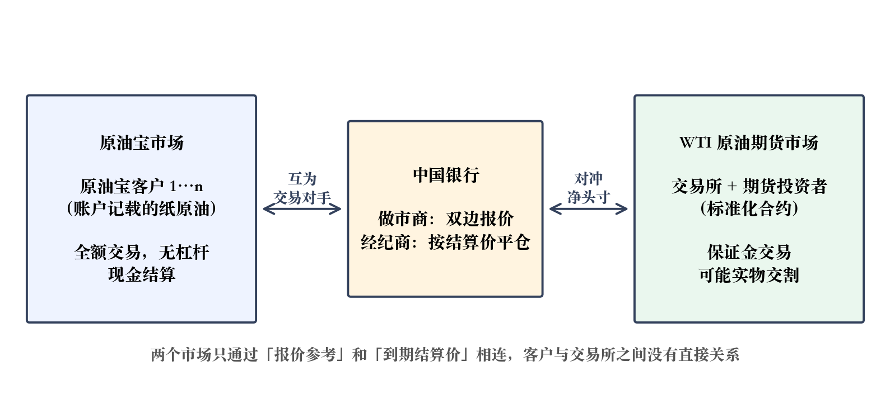
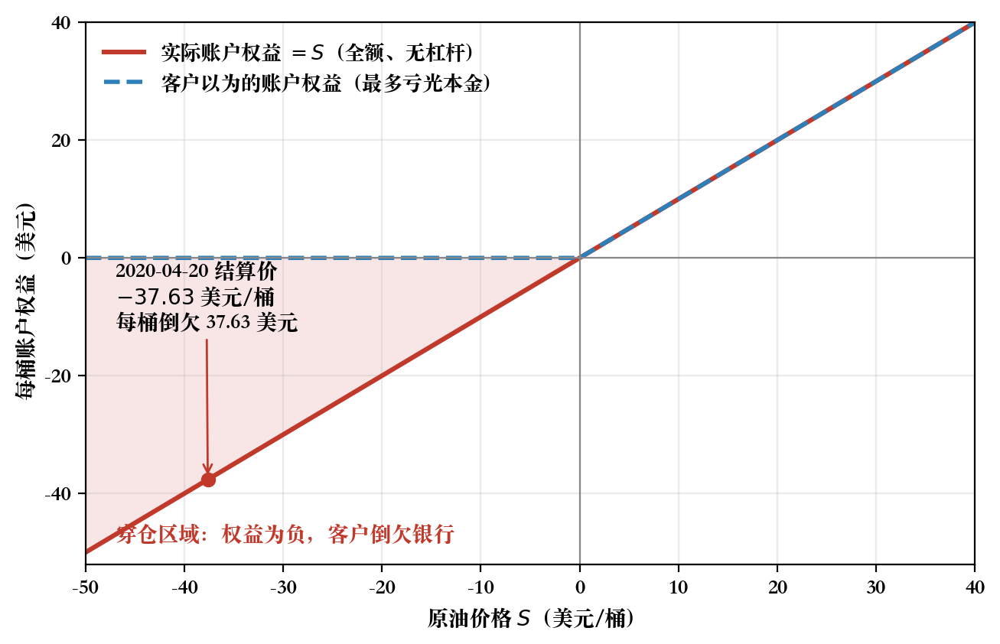
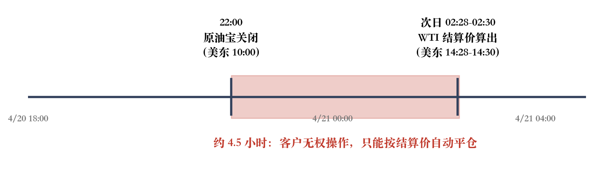

# 事件背景

2020 年 4 月 20 日，WTI 2005 原油期货合约的结算价为 $-37.63$ 美元/桶（折合人民币 $-266.12$ 元/桶），这是原油期货历史上第一次出现负价格（案例 p6）。中国银行面向个人客户的「原油宝」产品挂钩该合约，6 万多名做多客户不仅亏光本金，还倒欠银行债务，这种亏损超过保证金、账户权益为负的情形称为**穿仓**。2020 年 12 月，银保监会指出中行在产品管理、风险管理、内控管理和销售管理四个方面存在问题，并作出处罚（案例 p7）。

本报告以案例材料为基础，结合《金融衍生工具》第 2、3 讲的内容，依次回答三个问题：原油宝与原油期货有什么区别；WTI 2005 价格为什么会跌成负值；如何避免穿仓再次发生。**报告的作图脚本与图表见 <https://github.com/aylmerwawa/derivatives-lab1-crude-oil-treasure>**。@tbl-timeline 列出事件的主要节点。

| 日期 | 事件 | 案例页码 |
|:--------------|:--------------------------------------------|:------:|
| 3 月 6 日 | OPEC+ 谈判破裂，随后沙特宣布降价增产，原油价格战开始 | p4–5 |
| 3 月 9 日 | 「黑色星期一」，WTI 5 月合约收盘 30.6 美元/桶，美股熔断；3 月 12、16、18 日再次熔断 | p5 |
| 4 月 12 日 | OPEC+ 达成减产协议，仍难以抵消需求下滑 | p5 |
| 4 月 15 日 | CME 公告：能源期货出现 0 或负的结算价时，交易和清算系统照常运行 | p5 |
| 4 月 20 日 22:00（北京时间） | 原油宝关闭，客户无权再操作 | p5 |
| 4 月 20 日美东 14:28–14:30 | WTI 2005 结算价按最后 3 分钟产生，为 $-37.63$ 美元/桶 | p5–6 |
| 4 月 21 日 | WTI 价格回到正数 | p6 |
| 5 月 1 日 | 银保监会关注事件，提醒中行依法依规处置 | p1 |
| 12 月 5 日 | 银保监会公布处罚，指出四方面问题 | p7 |

: 事件主要节点 {#tbl-timeline}

# 原油宝与原油期货的区别

## 原油宝是什么

原油宝是中国银行 2018 年 1 月起开办的个人账户「纸原油」业务：银行向投资者提供报价，以**账户记载**的形式与投资者买卖原油合约，投资者可以做多，也可以做空（案例附录 1）。产品挂钩境外原油期货价格，主要是 WTI 和 Brent；最小交易单位是 0.1 桶；**全额交易、无杠杆**；现金结算，不涉及实物交割。

中国银行在其中同时扮演两个角色（@fig-roles）：

- **做市商**：在原油宝市场向客户提供双边报价，与客户互为交易对手；轧平多空头寸后，再通过海外经纪公司进入真实的期货市场，对冲剩下的净头寸
- **经纪商**：原油宝关闭之后，替客户按交易所的结算价平仓（案例图 4）

{#fig-roles width=92%}

## 两者的对比

@tbl-compare 从八个维度对比原油宝和 WTI 原油期货。

| 维度 | 原油宝 | WTI 原油期货 | 依据 |
|:-------|:----------------------|:----------------------|:--------------|
| 交易对象 | 银行账户上记载的「纸原油」 | 交易所统一制定的标准化合约 | 案例附录 1；课件第 2 讲 p20 |
| 对手方与定价 | 客户与中行互为对手方；中行双边报价，报价只参考期货价格，并不完全挂钩 | 交易所集中撮合，价格由众多投资者的供求形成 | 案例 p3、附录 1 |
| 合约规模 | 最小 0.1 桶 | 一手 1000 桶（交易所合约规格） | 案例附录 1 |
| 保证金与杠杆 | 全额交易，无杠杆 | 只缴合约价值一定比例的保证金，有杠杆 | 案例附录 1；课件第 2 讲 p54–60 |
| 风险控制 | 保证金比例低于银行规定的比例时，由银行强制平仓 | 逐日结算，当日无负债；不足时追加保证金，否则强行平仓 | 案例附录 1；课件第 2 讲 p53–58 |
| 结算方式 | 现金结算，不涉及实物交割 | 到期未平仓者须实物交割（实际交割率很低，案例称不足 1\%） | 案例 p2、附录 1；课件第 2 讲 p65 |
| 交易时间 | 有自己的交易时间，4 月 20 日 22:00（北京时间）关闭 | 国际期货市场几乎连续交易 | 案例 p5、p7 |
| 规则与保护 | 规则由银行制定，客户与银行之间的合约 | 交易所统一的制度（九项交易制度） | 案例 p3、p7；课件第 2 讲 p53 |

: 原油宝与 WTI 原油期货的对比 {#tbl-compare}

## 两者的联系

案例指出，原油宝只是模拟出来的期货交易场景，和 WTI 期货市场除了报价上存在关联以外，本质上是毫不相干的两个市场（案例 p2–3）。它们通过两个环节相连：一是报价参考期货价格；二是在原油宝关闭之后，按交易所的结算价了结客户头寸（案例图 4）。

平时这种连接很松，银行报价与期货价格可以有差异；但在极端行情下它变成硬连接：期货出现 $-37.63$ 美元的结算价，客户的头寸就被直接按这个价格了结。

用第 2 讲「期货与远期」的对照来看（课件 p43），原油宝不在交易所交易、条款由银行制定、对手方是银行，更接近**场外合约**；但它以期货结算价了结，价格风险按期货的规则传导，而保护措施（交易所的当日无负债结算、强行平仓）却是按银行自己的规则执行。

## 小结

原油宝与原油期货有三个本质区别：交易的是**账户记载的纸合约**还是交易所的标准化合约；**对手方和规则**是银行还是交易所；**风险缓冲**由银行自己设计还是由交易所制度提供。客户以为买到的是「无杠杆的期货」，实际签的是与银行的合约，规则由银行制定，这是后面穿仓问题的起点。

# WTI 2005 价格跌为负值的原因

## 需求骤降

2020 年初新冠疫情暴发，出行限制使飞机、汽车、火车等交通用油（占全球石油需求近 $60\%$）大幅下降。自 1 月 31 日起，中国原油进口额线性下降，直到 5 月 31 日才开始回升（案例 p4），这从侧面反映了需求的紧缩。

## 供给过剩

3 月 6 日 OPEC+ 谈判破裂，3 月 7 日沙特宣布降价增产，原油价格战爆发。3 月 9 日 WTI 5 月合约收盘 30.6 美元/桶，日间最低价下跌超过 $30\%$，此后 3 月 12、16、18 日接连熔断（案例 p4–5）。4 月 12 日 OPEC+ 达成减产协议，国际能源署称这是史上最大规模的减产，但仍无法抵消需求的下降。

## 库容耗尽与实物交割困难

需求下降、供给过剩的直接后果是库存快速增加。标准普尔估计全球原油、石油产品和液化石油气的储存能力约为 14 亿桶，4 月底储量将达到 13 亿桶；国际能源署推算 6 月全球将达到库容极限。WTI 实物交割地是美国俄克拉荷马州的库欣，那里的管道几乎都被生产商预订。没有交割能力的投机者即使可以接货，也要支付运输、储存等成本，于是倒贴钱也不愿意把原油运回来，价格因此变成负数（案例 p5–6）。

## 为什么期货价格可以为负

案例给出了现象和原因，这里用课件的概念把「价格为什么能低于零」解释清楚。

**（1）期货多头是义务，不是权利。** 期货属于权利义务对称的合约（课件第 1 讲 p22），多头承诺在到期日以约定的价格买入标的。这个价格是**交割价格**，不是资产的价值，所以并没有「不会低于零」的下限；而期权的买方有权利可以不行权，损失才有下限。多头到期必须接货，当接货的成本大于货的价值时，愿意接货的人就要求被补贴，价格就为负。

**（2）到期时期货价格收敛到现货价格。** 临近到期，期货价格趋近现货价格，到期当天二者相等（课件第 2 讲 p37–38）。WTI 2005 到期时对应的是库欣的交割，所以近月合约价格就是「在库欣立即拿到一桶油」的价格，这个价格取决于有没有地方存油。

**（3）库容紧缺使持有成本的约束消失。** 消费性商品的期货价格有上限（课件第 3 讲 p46）：

$$
F \le (S + U)\,e^{r(T-t)}
$$

其中 $F$ 是远月期货价格，$S$ 是现货价格，$U$ 是存储成本的现值。移项得到现货价格的**下限**：

$$
S \ge F\,e^{-r(T-t)} - U
$$

它的含义是：现货价格太低时，套利者会买入现货、储存、同时卖出远月期货，到期交割赚取差价，这个行为把现货价格托在下限之上。但前提是**有库容**。库容耗尽之后，这个套利无法进行，下限就失效了。

用一个示意数字说明（不是案例数据）：设远月合约价格 $F=25$ 美元，忽略利率，库容极度紧张时储存和运输一桶油的综合成本 $U=60$ 美元，则 $S \ge 25-60=-35$ 美元，现货价格可以跌到 $-35$ 而没有套利机会。负价格的大小，反映的就是接一桶油要付出的储存成本。

**（4）流动性不足放大了波动。** WTI 的结算价按美东时间 14:28 到 14:30 的最后 3 分钟产生。临近最后交易日，市场流动性不足，最后三分钟的价格依次是 $-39.55$、$-37.11$ 和 $-36.37$ 美元，最终结算价为 $-37.63$ 美元（案例 p6）。

## 小结

负价格的形成可以概括为一条因果链：**需求骤降加供给过剩，导致库存激增；库容耗尽使存储成本急剧上升，套利无法托住现货价格；临近到期，多头必须接货又无力接货，只能不计价格地抛售；在流动性不足的最后三分钟形成负的结算价**。

# 如何避免「穿仓」再次发生

## 穿仓是怎么发生的

原油宝是全额、无杠杆的产品（案例附录 1）。设客户以价格 $P$ 买入，保证金正好等于 $P$：

$$
\text{账户权益} = \text{保证金} + \text{盈亏} = P + (S - P) = S
$$

账户权益等于现价 $S$，和入场价无关。价格为正时，最多亏光本金；价格为负时，账户权益也是负的，客户倒欠银行（@fig-account）。案例 p5 里的投资者想的正是「最坏的结果无非是亏光本金」，这在价格不会为负时成立，价格一旦为负就被打破了。

举一个示意数字（不是案例数据）：持有 100 桶，结算价为 $-266.12$ 元/桶，倒欠 $266.12\times100=26{,}612$ 元，与案例所说的「负债上万」相符。

{#fig-account width=78%}

## 时间差和盯市缺口

案例指出：原油宝在 4 月 20 日 22:00（北京时间，相当于美东 10:00）关闭，而 WTI 的结算价在美东 14:28 到 14:30（北京时间次日 02:28 到 02:30）才算出来，相差约 4.5 小时。关闭之后客户无权操作，只能按结算价自动平仓（案例 p5，@fig-time）。

{#fig-time width=95%}

中行的解释是 22:00 系统关闭后工作人员不再盯市，保证金比例也没有低于规定的 $20\%$，所以没有强制平仓；案例批评这对 24 小时交易的产品是严重的风险管理疏漏（案例 p7）。此外，CME 在 4 月 15 日已公告允许出现零或负的结算价，中行没有及时提示客户，系统里甚至没有填写负价格的设定，销售端还在鼓励投资者抄底（案例 p5、p7）。

## 对策

@tbl-measures 把对策按问题归类，并指出依据和成本。

| 措施 | 针对的问题 | 依据 | 成本与代价 |
|:--------------------------|:----------------|:-------------|:------------------|
| 在产品规则里设「负价格保护」：客户最大损失以本金为限，超出部分由银行承担 | 全额无杠杆却会穿仓 | 账户权益等于现价的推导；案例 p5–6 | 相当于银行向客户提供一份行权价为 0 的看跌期权，需要计入产品定价或对冲 |
| 把原油宝的最后交易时间与 WTI 结算时间对齐，或在到期前更早强制移仓、平仓，并在流动性充足时完成 | 关闭后约 4.5 小时无法操作；中行自己的移仓压力 | 案例 p3、p5 | 手续费、冲击成本、近远月价差带来的移仓成本，客户会看到「移仓亏损」 |
| 支持负价格，24 小时盯市，自动强平不依赖人工；在 CME 公告后立即压力测试 | 22:00 后不再盯市；系统无法填写负价格 | 案例 p5、p7 | 系统改造和人力成本 |
| 如实揭示风险（含负价格），不鼓励抄底，做好适当性匹配 | 风险告知不足，销售不合规 | 案例 p5、p7；课件第 2 讲 p61 适当性管理义务 | 销量下降 |
| 前中后台分离，设置独立的风险限额；监管上对「纸原油」按期货市场的制度要求，如当日无负债结算和强行平仓 | 产品管理不规范、内控不健全 | 案例 p7 银保监会四点；课件第 1 讲 p47、第 2 讲 p53 | 创新空间受限，合规成本上升 |
| 投资者教育：全额无杠杆不等于最多亏本金；临近到期慎持有 | 对风险的认知不足 | 案例结语「永远赚不到认知以外的钱」 | 需要长期投入 |

: 避免穿仓的对策 {#tbl-measures}

**产品规则是根本。** 穿仓的根源不是油价跌，而是产品规则让客户承担了超出本金的损失。把客户的最大损失限定在本金之内，是最直接的办法。它的代价是银行承担了价格转负的尾部风险，这相当于卖出一份行权价为 0 的看跌期权，必须计入定价；中行当时没有做这件事，最终承担了穿仓的全部损失（案例 p7）。

**时间安排要与市场对齐。** 把关闭时间提前到流动性充足的时段，并强制移仓，可以避免客户在最后几分钟被动接受极端的结算价。但移仓不是没有成本：同样一笔钱在近月和远月合约之间移动，要承担价差和交易成本，中行不愿意这样做的原因之一，就是这笔确定的成本。比较之下，一笔确定的小成本换取避免一个小概率的巨大损失，是合理的取舍。

**风控和销售不能只靠制度文字。** 24 小时盯市、自动强平、压力测试都要落实到系统和流程上；CME 公告之后，银行应当重新评估产品条款，而不是继续鼓励抄底。适当性管理义务（课件第 2 讲 p61）要求把合适的产品卖给合适的客户，对复杂的衍生品类产品尤其如此。

## 小结

中行原油宝的穿仓是**产品设计、风险管理和销售管理三个层面的问题叠加**的结果：产品规则让客户承担超过本金的损失，系统关闭与结算之间有 4.5 小时的盯市空白，风险揭示不足。任何单独一项对策都不够，需要同时从规则、流程和适当性三个方面入手。

# 结论

原油宝是银行与客户之间的「纸原油」合约，只在报价和到期结算价上与 WTI 期货相连，规则由银行制定，这与交易所的标准化期货有本质区别。WTI 2005 价格转负，是需求骤降、供给过剩、库容耗尽、多头无力接货和最后三分钟流动性不足共同作用的结果，从期货机制看，是因为期货多头是义务，到期收敛到库欣的交割价格，而库容紧缺使持有成本的下限失效。穿仓则是因为全额无杠杆的产品在价格转负时账户权益也为负，加上时间差和风险管理、销售管理上的缺口。避免再次发生，需要把客户的最大损失限定在本金之内、让关闭时间与市场结算对齐、落实盯市和风险揭示，并加强适当性管理和投资者教育。

# 参考材料 {.unnumbered}

1. 满媛媛，李慧晶，吴连伟，孙奇．中行「原油宝」穿仓事件：永远赚不到认知以外的钱［教学案例］．中国管理案例共享中心案例库（含附录 1–4：纸原油的基本机制、中国银行 2020 年 4 月 24 日和 29 日的公告、中国银保监会的处罚公告与中行回应）。
2. 江婕．金融衍生工具课件：第 1 讲 导论、第 2 讲 期货市场运作机制、第 3 讲 远期和期货价格的确定．北京师范大学．
